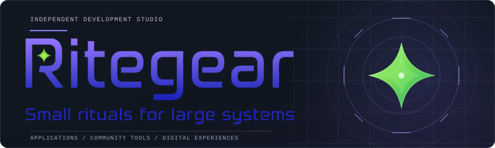
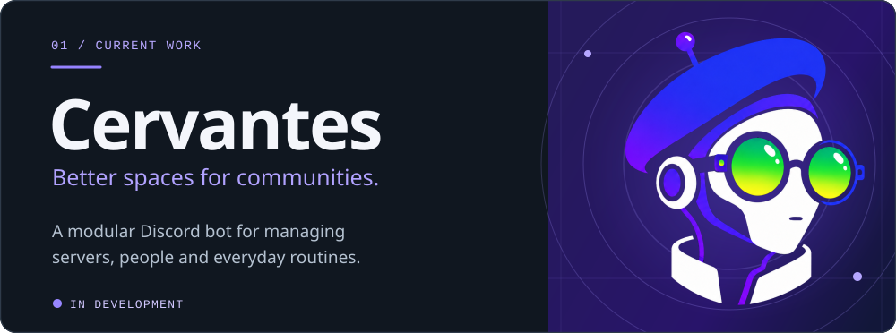
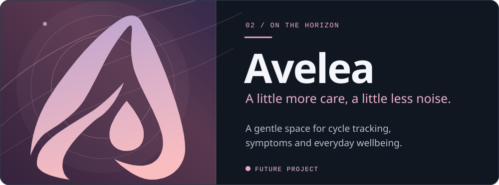

  

 

## Projects

  

A modular Discord bot for multi-server communities. Its PostgreSQL-backed infrastructure, permissions and monitoring are in place; community tools and moderation workflows are on the roadmap.

[**Repository**](https://github.com/Ritegear/Cervantes) &nbsp;·&nbsp; [**Documentation**](https://cervantes.ritegear.dev/) &nbsp;·&nbsp; [**Roadmap**](https://cervantes.ritegear.dev/roadmap/)

 

  

A future mobile app for cycle and symptom tracking, with a calm interface and minimal distractions. Early Flutter foundations exist; the product is not yet released.

[**Repository**](https://github.com/Ritegear/Avelea) &nbsp;·&nbsp; [**Documentation**](https://avelea.gitbook.io/avelea/) &nbsp;·&nbsp; [**Contact**](mailto:avelea.app@protonmail.com)

 

  

  Copyright © Ritegear. All rights enchanted.

