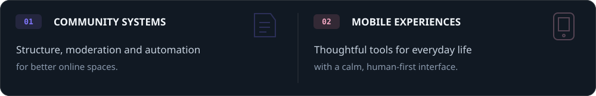
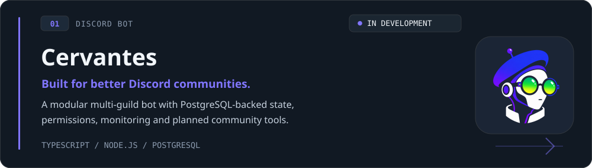
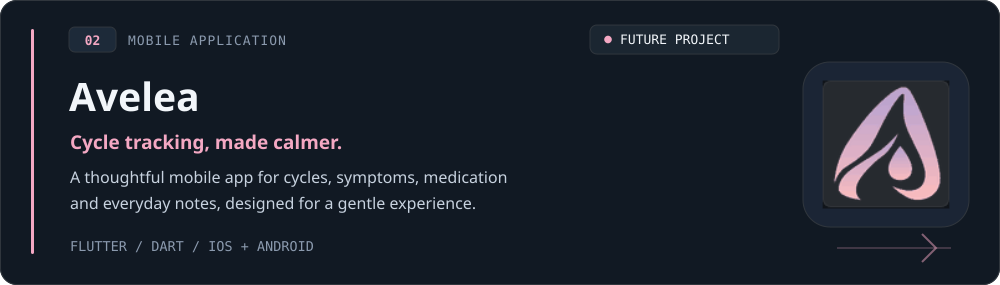

  

  <strong>Independent development studio</strong> 
  Thoughtful community tools, mobile experiences, and small pieces of useful software.

 

  

## Projects

  

  <a href="https://github.com/Ritegear/Cervantes">Repository</a>
  &nbsp;·&nbsp;
  <a href="https://cervantes.ritegear.dev/">Documentation</a>
  &nbsp;·&nbsp;
  <a href="https://cervantes.ritegear.dev/roadmap/">Roadmap</a>

Cervantes is a modular, multi-guild Discord bot designed to reduce routine work and make communities easier to manage. It is in **early development**, with PostgreSQL-backed server state, capability-based permissions, management safeguards, observability, and deployment foundations already in the codebase. Interactive community panels, moderation workflows, LFG tools, and activity systems are **planned**, not yet released.

 

  

  <a href="https://github.com/Ritegear/Avelea">Repository</a>
  &nbsp;·&nbsp;
  <a href="https://avelea.gitbook.io/avelea/">Project documentation</a>
  &nbsp;·&nbsp;
  <a href="mailto:avelea.app@protonmail.com">Contact</a>

Avelea is a **future mobile project** focused on menstrual cycle tracking, symptoms, medication, and everyday notes. Its direction is a gentle, accessible interface built with Flutter for iOS and Android. Early project work exists, but Avelea is presented here as a future product rather than a released app.

 

---

  <a href="mailto:info@ritegear.dev">info@ritegear.dev</a>

  Copyright © Ritegear. All rights enchanted.

