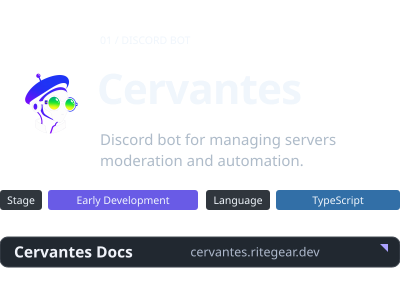
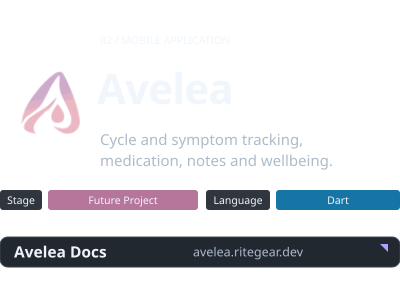

  

  <strong>Software development studio</strong> 
  Mobile apps · Discord bots · Community tools

## Projects

---

  CONTACT 
  <a href="mailto:info@ritegear.dev"><code>info@ritegear.dev</code></a>

   
  Copyright © Ritegear. All rights enchanted.

